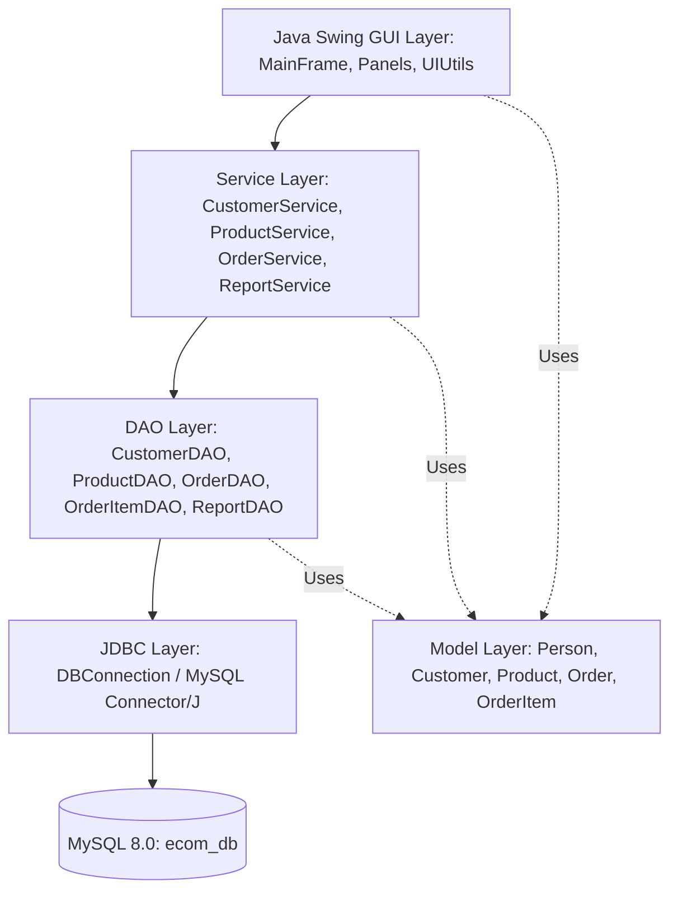
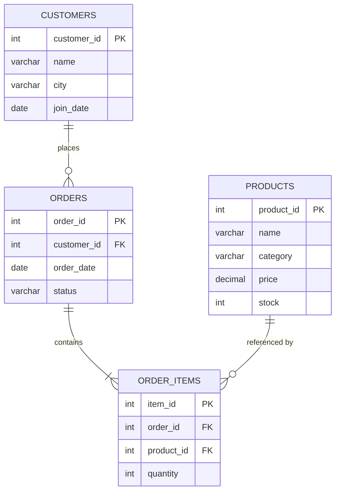
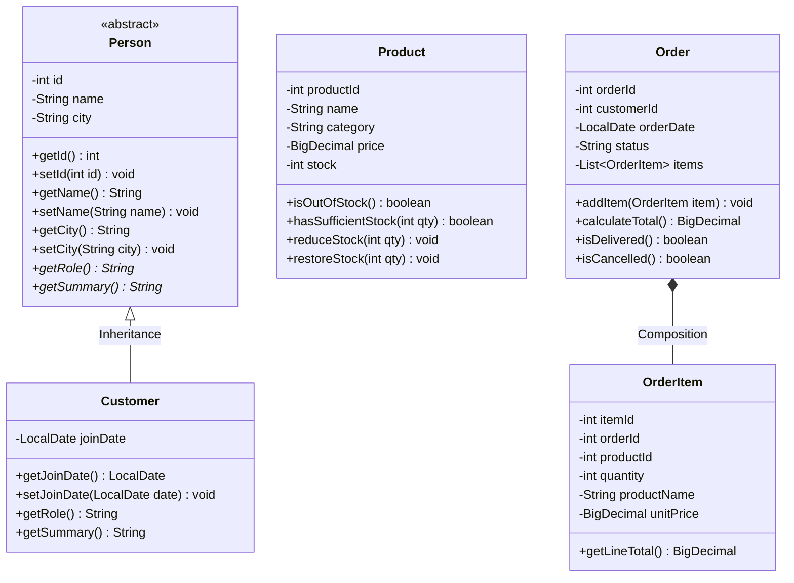

# Architecture & OOP Design Documentation

This document explains the architecture, database relational model, and Object-Oriented Programming (OOP) design patterns implemented in the **E-Commerce Store Management System** for faculty evaluation.

---

## 1. System Architecture

The application follows a clean 4-tier layered architecture:



- **Presentation Layer (Swing GUI)**: Responsive desktop interface styled with FlatLaf Light, organizing workflows into Dashboard, Customers, Products, Cart/Order Creation, Order History, and 15 SQL Reports.
- **Service Layer**: Coordinates business transactions, boundary validation, and atomicity (e.g. inventory pre-check and atomic multi-item order placement with rollback).
- **Data Access Object (DAO) Layer**: Decouples business logic from SQL persistence using parameterized `PreparedStatement` queries and `try-with-resources`.
- **Database Connection Layer**: `DBConnection` manages connection lifecycle, sanitizes error logs, and reads credentials from environment variables (`ECOM_DB_USER`, `ECOM_DB_PASSWORD`) or git-ignored local properties.

---

## 2. Entity-Relationship (ER) Diagram

The relational schema strictly maintains the 4 required tables in `ecom_db`:



### Relational Constraints:
- `orders.customer_id` references `customers.customer_id` (1:N). Attempting to delete a customer who has orders is blocked with a clear user alert.
- `order_items.order_id` references `orders.order_id` (1:N).
- `order_items.product_id` references `products.product_id` (1:N). Attempting to delete a product that exists in order history is blocked.

---

## 3. UML Class Diagram & OOP Principles



---

## 4. Academic Demonstration of the 4 Core OOP Principles

### 1. Encapsulation
- **Implementation**:
  - All attributes in model classes (`Person`, `Customer`, `Product`, `Order`, `OrderItem`) are marked `private`.
  - Access is restricted exclusively through public getters and validated setters.
  - Boundary checks:
    - `Product.setPrice()` rejects negative amounts (`price.compareTo(BigDecimal.ZERO) < 0`).
    - `Product.setStock()` rejects negative quantities (`stock < 0`).
    - `OrderItem.setQuantity()` enforces positive quantities (`quantity > 0`).
    - `Customer.setName()` and `Customer.setCity()` reject null or blank strings.
    - `Order.setStatus()` validates against allowed states (`Delivered`, `Shipped`, `Pending`, `Cancelled`).

### 2. Inheritance
- **Implementation**:
  - `Person` is defined as a base class containing shared personal attributes (`id`, `name`, `city`) and common accessor methods.
  - `Customer extends Person` inherits these fundamental attributes and adds customer-specific attributes (`joinDate`).
  - Code reuse: Customer reuses the validation, hashing, equality, and formatting logic defined in `Person`.

### 3. Abstraction
- **Implementation**:
  - `Person` is declared as an `abstract class` (`public abstract class Person`). It cannot be directly instantiated.
  - Declares abstract methods:
    ```java
    public abstract String getRole();
    public abstract String getSummary();
    ```
  - DAO Interfaces (`CustomerDAO`, `ProductDAO`, `OrderDAO`, `OrderItemDAO`, `ReportDAO`):
    - Separate the *what* from the *how*. Higher layers (services and GUI) interact with persistence interfaces rather than direct SQL queries.

### 4. Runtime Polymorphism
- **Implementation**:
  - `Customer` overrides the abstract methods from `Person`:
    ```java
    @Override
    public String getRole() {
        return "Customer";
    }

    @Override
    public String getSummary() {
        return String.format("Customer #%d: %s from %s (Member since: %s)",
                getId(), getName(), getCity(), joinDate);
    }
    ```
  - **Dynamic Method Dispatch**:
    ```java
    Person p = new Customer(1, "Anita", "Chennai", LocalDate.of(2025, 11, 10));
    System.out.println(p.getRole()); // Resolves dynamically at runtime to Customer.getRole()
    ```
  - Verified programmatically in [`OOPModelTest.java`](file:///d:/ECommerceStore/src/test/java/com/ecommerce/model/OOPModelTest.java).

---

## 5. JDBC Transaction Management

Multi-product order creation enforces strict ACID semantics in [`OrderService.java`](file:///d:/ECommerceStore/src/main/java/com/ecommerce/service/OrderService.java):

```java
conn.setAutoCommit(false); // Begin Transaction
try {
    // 1. Validate customer existence
    // 2. Lock & pre-check stock for ALL items (FOR UPDATE)
    //    If any stock < requested: throw InsufficientStockException
    // 3. Insert order header into orders table
    // 4. Batch insert all line items into order_items table
    // 5. Decrement stock for all ordered products
    conn.commit(); // Atomic Commit
} catch (Exception ex) {
    conn.rollback(); // Complete Rollback (Zero Partial Orders)
    throw ex;
} finally {
    conn.setAutoCommit(true);
    conn.close();
}
```

Stock restoration on order cancellation:
- Reads order items.
- Restores each product's stock: `UPDATE products SET stock = stock + ? WHERE product_id = ?`.
- Updates order status to `'Cancelled'`.
- Commits atomically.
